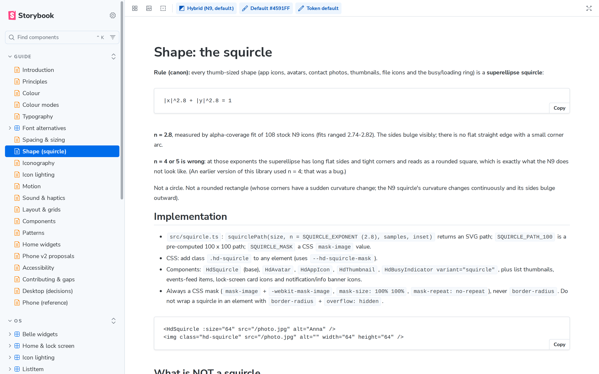
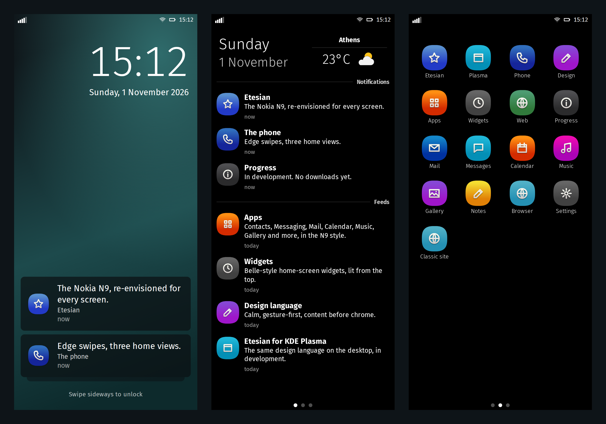

<p align="center">
  
</p>

<h1 align="center">Etesian Design</h1>

<p align="center">
  <b>Etesian's design language, written down and built as Vue 3 components.</b><br>
  Squircles, lit icons, big plain type and content before chrome, for phones, desktops and the web.
</p>

<p align="center">
  <a href="https://language.etesian-design.com">Browse the guide</a> ·
  <a href="https://etesian-design.com">Website</a> ·
  <a href="https://github.com/etesian-design/android_vendor_etesian">Phone (LineageOS)</a> ·
  <a href="https://github.com/etesian-design/plasma">KDE Plasma</a>
</p>

<p align="center">
  
  
  <a href="https://language.etesian-design.com"></a>
</p>

---

This repository is the Etesian design system: the guide, the npm packages and the Storybook. Etesian is a
cross-platform design language that re-envisions the Nokia N9's Swipe UI for today; it is not a copy of the N9. The
guide works out its rules, from the exact curve of an icon's corner to how a list scrolls, and turns them into
something you can build with.

Everything the [Etesian phone](https://github.com/etesian-design/android_vendor_etesian), the
[Plasma desktop](https://github.com/etesian-design/plasma) and the [website](https://etesian-design.com) look like comes
from here.

**Related projects.** Etesian runs on an [Android ROM](https://github.com/etesian-design/android_vendor_etesian) for any
LineageOS phone (the F(x)tec Pro1-X is only the reference device), on [KDE Plasma](https://github.com/etesian-design/plasma)
and on the [web](https://github.com/etesian-design/website), with S60 planned later. [Cloud Companion](https://github.com/Phorepoc/cloud-companion), a
Phorepoc project for any device, wears this look on its web desktop.

## What's inside

- **The guide.** Colour, type, spacing, the squircle, icons, motion and sound, plus how the phone and the desktop behave. Every value says whether it was measured from the N9 or worked out for Etesian.
- **Components.** Buttons, lists, sheets, toolbars, the Events feed, the lock screen, home widgets and more, as `Hd*` Vue components.
- **Design tokens.** One `tokens.json`, generated into CSS variables and TypeScript.
- **Full mock-ups.** Clickable phone and desktop prototypes in Storybook, built from the same components.

<p align="center">
  
  <br><sub>A phone built from these components: the lock screen, Events and Applications.</sub>
</p>

## Get started

```sh
npm install
npm run storybook
```

That opens the guide and every component. To use it in your own app, install the packages from GitHub Packages (it
needs a GitHub token with `read:packages` in `~/.npmrc`, even for public packages):

```sh
echo "@etesian-design:registry=https://npm.pkg.github.com" >> .npmrc
npm install @etesian-design/vue @etesian-design/tokens     # and @etesian-design/quasar, @etesian-design/shell
```

| Package | What it is |
|---|---|
| `@etesian-design/tokens` | The design tokens as CSS and TypeScript, and the free font alternatives to Nokia Pure |
| `@etesian-design/vue` | The `Hd*` components, composables and squircle geometry |
| `@etesian-design/quasar` | The Quasar 2 theme and integration |
| `@etesian-design/shell` | The desktop, the mini apps and the Belle home-screen widgets |

`npm run build` builds all four into `packages/*/dist`; pushing a `v*` tag publishes them.

| Command | What it does |
|---|---|
| `npm test` | Type check, then render every component and story |
| `npm run tokens` | Regenerate CSS and TypeScript from `tokens/tokens.json` |
| `npm run build-storybook` | A static Storybook to host anywhere |

## Licence

MIT. The icons are original; no Nokia fonts, icons, wallpapers or sounds are included.

Etesian is an independent project and isn't affiliated with Nokia.
